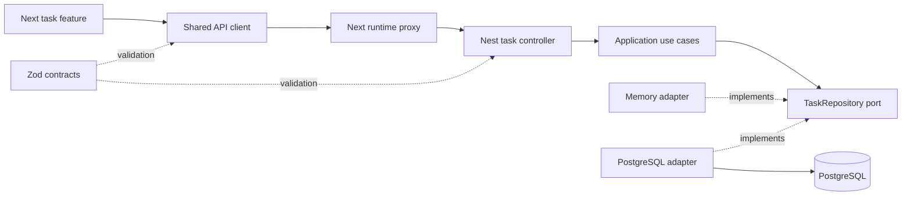

# Architecture

## Dependencies and runtime flow

The dashed adapter arrows describe dependency direction. At runtime Nest factory
providers inject the selected adapter into the use cases. The frontend never
imports server implementation files or database entities.

## Boundary rules

| Area                  | Allowed responsibilities/dependencies                   |
| --------------------- | ------------------------------------------------------- |
| `packages/contracts`  | Transport schemas, inferred types, Zod                  |
| `packages/api-client` | Contracts, HTTP transport, response validation          |
| API domain            | Its own entity and port files; no external libraries    |
| API application       | Domain interfaces/entities and application errors       |
| API infrastructure    | Implements ports using memory or PostgreSQL             |
| API presentation      | Nest controllers, DTO adaptation, use case calls        |
| Nest modules          | Composition roots: connect concrete dependencies        |
| Web features          | Feature-local UI and hooks, shared components/libraries |
| Web app               | Compose features, routes, providers, server entrypoints |
| Web server library    | Fixed-origin proxy and server environment values        |

`pnpm boundaries` reads TypeScript import/export/dynamic-import syntax, resolves
local aliases, checks dependency manifests and public exports, rejects cross-package
relative imports, enforces inward API dependencies and frontend feature isolation,
and detects workspace dependency cycles. TypeScript and explicit package exports
provide a second layer. This is not a general-purpose whole-program dependency analyzer;
computed imports and runtime file loading should not be used to bypass the architecture.

The default ESLint rules add correctness and React Hooks checks. Typed DTO imports
are kept as runtime values in the backend because Nest uses decorator metadata.

## API contract

| Method  | Path                   | Result                                                  |
| ------- | ---------------------- | ------------------------------------------------------- |
| `GET`   | `/api/v1/tasks`        | `{ items: Task[] }`, latest 100 by created time then ID |
| `POST`  | `/api/v1/tasks`        | Create `{ title }`, return task with 201                |
| `PATCH` | `/api/v1/tasks/:id`    | Set `{ status: "open" \| "done" }`, return task         |
| `GET`   | `/api/v1/health/live`  | Process is serving requests                             |
| `GET`   | `/api/v1/health/ready` | Storage and migrated tasks table are available          |

The title is trimmed, nonblank, and at most 120 JavaScript string code units.
Unexpected request properties are rejected. Responses are validated during Nest
serialization and again at the HTTP client boundary. Browser typing alone is never
treated as validation. The sample has bounded recent results, not cursor pagination.
Add a cursor contract and supporting query/index when the product needs older data.

Errors from Nest use `{ status, code, message, requestId }`. Unexpected details stay
out of responses; `x-request-id` correlates application errors with server logs.
Errors rejected directly by the HTTP platform may use its own error representation;
the client handles unknown/non-JSON error payloads safely.

## State and concurrency

Domain entities are immutable. Use cases receive their repository, clock, and ID
generator explicitly. PostgreSQL updates status in one statement rather than a
read-modify-write cycle. Setting a status is idempotent, with the latest committed
write taking effect. More complex aggregate changes should use a transaction and
explicit version/locking policy where required.

TanStack Query owns frontend server state. Local React state owns the input and
filter. Successful mutations invalidate the task query; retries are disabled for
mutations to avoid automatically repeating task creation. Failed input is preserved.
Queries can be cancelled and HTTP requests have a timeout. Private query keys include the account ID. Session transitions cancel work and remove
private cache entries; HTTP refresh is coordinated and retried once. There is no
separate global state store for data already managed by the query cache.

## Configuration and runtime behavior

Nest configuration is validated once at startup. PostgreSQL mode requires its URL;
production refuses memory mode. The pool closes through Nest lifecycle hooks.
Migrations are explicit and do not run on each API process startup. Both task adapters have matching recent-order semantics and filter by the authenticated
owner. Identity and media also have memory/PostgreSQL ports and adapters. Database file
bytes are transactional; object storage uses a replaceable S3 adapter with metadata
failure compensation.

The Next proxy permits only listed task, health, identity, and media resources, forwards only exported HTTP
methods to a fixed server-configured origin, bounds request bodies, rejects redirects,
times out upstream calls, and prevents caching API responses. It never accepts an
upstream URL from the caller. Only the named access/refresh cookies and explicitly supplied Authorization header
are forwarded. Separate Set-Cookie headers are preserved. Unsafe operations require
a custom CSRF header and matching Origin checks. See `foundation-features.md` for
the implemented identity, media, and query-cache boundaries.

The API uses small body limits, generated request IDs, headers, and an in-process
rate limiter. With multiple API replicas, choose an ingress or shared rate-limit
store. Do not trust forwarded client IP headers until the deployment's proxy chain
is explicitly configured. Swagger is disabled by default in production.

The UI uses semantic controls, visible labels, focus rings, status announcements,
responsive layout, and reduced-motion handling. It deliberately uses local system
fonts so startup and production builds do not need a font CDN.

## Adding another feature

1. Define only the browser-safe request and response schemas in `contracts`.
2. Add the API feature's domain and repository port. Do not start with empty layers.
3. Implement use cases independent of Nest. Add a persistence adapter and migration.
4. Adapt HTTP inputs/outputs in a controller. Wire providers in the feature module.
5. Expose client operations through `api-client` and allowlist new proxy resources.
6. Add frontend feature components/hooks and compose them from the app route.
7. Test important behavior, error paths, HTTP contracts, and actual database behavior.
8. Run `pnpm check`; review and test migrations against a disposable database.

Extract a package only when it has an actual independent consumer or ownership
boundary. Keep business modules in the API until there is a reason to move them.
Introduce workers, queues, event buses, distributed transactions, or microservices
when a concrete product requirement makes their operational cost worthwhile.

## Foundation modules

Read [foundation features](foundation-features.md) for authentication, profile and media
contracts, cookie/CSRF policies, SQL transactions, storage limits, runtime variables,
and tested browser behavior. Password and token adapters live in identity infrastructure;
application services depend on their ports. The default authorization rule is authenticated
access, with explicit public-route metadata for session bootstrap/auth entrypoints and health.

## Email identity lifecycle

Registration commits a pending account and outbox job together. Verification is required
for login, refresh, and private routes, including accounts that existed before the migration.
Purpose-bound opaque credentials are consumed under the account lock. Password reset
atomically consumes the credential, changes the password, revokes sessions, and queues a
notification. A leased outbox worker sends through an EmailDelivery port; raw tokens are
not stored in jobs. See [email auth](email-auth.md) for retry, privacy, SMTP, and migration details.
